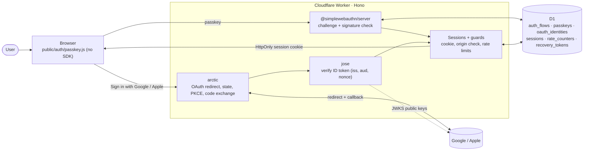
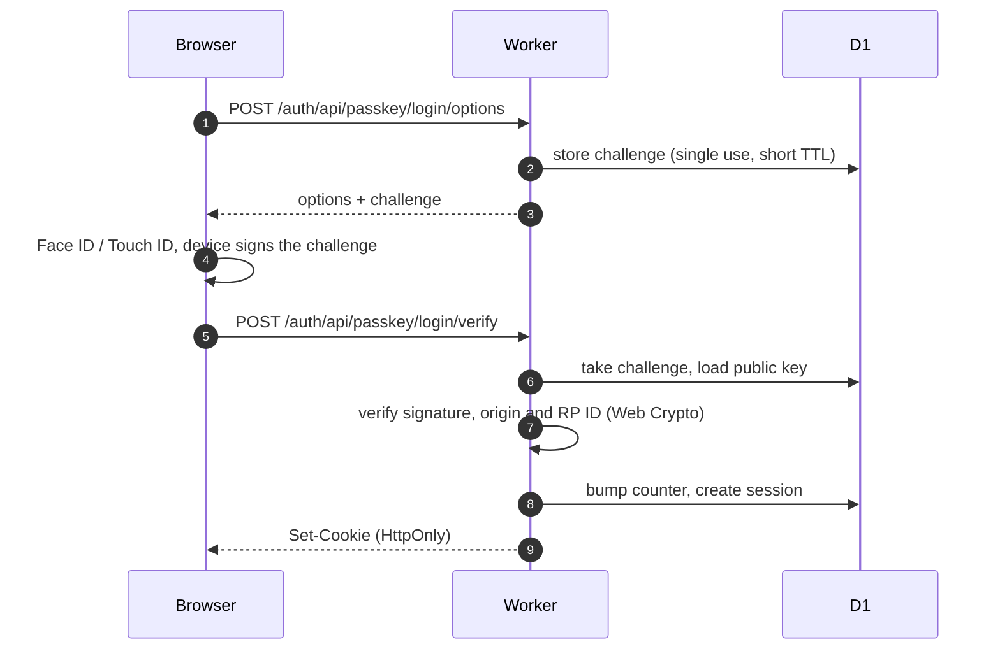

# workers-passkey-starter

Sign-in for a [Hono](https://hono.dev) app on Cloudflare Workers:

- **Passkeys:** usernameless sign-in, signup with username + display name, add / rename / remove passkeys, step-up ("confirm it's you") for sensitive actions.
- **Sign in with Google and Apple:** OpenID Connect, with linking and unlinking.
- **Sessions:** database sessions with instant revocation and "sign out everywhere".
- **Account lifecycle:** self-service account deletion, and recovery through a one-time link for someone who lost every passkey.
- **Hardening:** CSRF origin check, rate limits, security headers and an audit log.
- **Optional modules** (off by default): mail (Resend), e-mail verification, approval + admin, invites and signup links. See [Modules](#modules).

**D1 is the only store.** No auth framework, no KV, no Durable Objects, no in-memory state.

The code is extracted from a production app. Project-specific parts were removed; invites, admin approval and e-mail verification came back as generic, optional modules.

MIT licensed (see [LICENSE](LICENSE)).

## At a glance





An editable version of the architecture chart is in [docs/architecture.drawio](docs/architecture.drawio) (opens in diagrams.net; Lucidchart: File → Import → draw.io).

Contents: [At a glance](#at-a-glance) · [Quick start](#quick-start) · [How it works](#how-it-works) · [Integrate into an existing app](#integrate-into-an-existing-app) · [Configuration](#configuration) · [Google setup](#google-setup) · [Apple setup](#apple-setup) · [RP ID and origin pitfalls](#rp-id-and-origin-pitfalls) · [Why it fits Worker limits](#why-it-fits-worker-limits) · [Account deletion and recovery](#account-deletion-and-recovery) · [Modules](#modules) · [Routes](#routes) · [Instructions for coding agents](#instructions-for-coding-agents)

## Quick start

Node 22.5 or newer is needed; the tests use `node:sqlite`.

```bash
npm install
cp .dev.vars.example .dev.vars
npx wrangler d1 migrations apply DB --local
npm run dev
```

Open http://localhost:8787 and create an account with a passkey. Passkeys work on `localhost` over http. On any other host they need https.

Run the checks:

```bash
npm run check
```

That is the typecheck plus 120 tests, the modules included. They use an in-memory D1 and stub only the signature checks.

## How it works

```
Browser ── public/auth/passkey.js (no SDK) ──► Worker (Hono)
                                                ├─ @simplewebauthn/server   passkey options + verification
                                                ├─ arctic + jose            Google/Apple OAuth + ID-token checks
                                                └─ sessions, limits, CSRF   cookie, origin check, rate limits
Google / Apple (OIDC) ─────────────────────────► arctic + jose
All state ─────────────────────────────────────► D1: users, passkeys, oauth_identities, sessions, auth_flows, rate_counters, audit_log
```

| Part | Library / technique | File |
|---|---|---|
| Passkeys (server) | `@simplewebauthn/server` 14 | `src/auth/passkeys.ts` |
| Passkeys (browser) | Own code: native `PublicKeyCredential.parse…FromJSON` / `toJSON` with base64url fallbacks | `public/auth/passkey.js` |
| Google / Apple | `arctic` 3 (state, PKCE, code exchange, Apple's ES256 client secret) | `src/auth/oauth.ts` |
| ID-token check | `jose` 6 (`createRemoteJWKSet` + `jwtVerify`) | `src/auth/oauth.ts` |
| Router | `hono` 4 | `src/auth/routes.ts` |
| Crypto helpers | Web Crypto only | `src/auth/crypto.ts` |

### Passkeys

**Sign-in.** It is usernameless and uses discoverable credentials.

1. `POST /auth/api/passkey/login/options` (rate-limited) calls `generateAuthenticationOptions`. `allowCredentials` is empty and `userVerification` is `required`.
2. The challenge goes to the D1 table `auth_flows`. Flows are single use (`DELETE … RETURNING`) and expire after 10 minutes. Workers keep no memory between requests, so challenges never live in a variable.
3. `POST …/login/verify`:
   - looks up the credential;
   - refuses suspended users;
   - verifies against `APP_ORIGIN` + `PASSKEY_RP_ID` with user verification required;
   - moves the counter forward only (`MAX(counter, ?)`);
   - creates the session.
4. The browser calls the WebAuthn Signal API so password managers stay in sync:
   - `signalAllAcceptedCredentials` and `signalCurrentUserDetails` after sign-in;
   - `signalUnknownCredential` only when the server proves the passkey is orphaned (our user id, account gone).

**Safari.** WebKit only shows the passkey sheet if WebAuthn runs within the click. The client therefore fetches options ahead of time (`preparedOptions`). For signup, whose options depend on the form, it falls back to a second "Create passkey" click.

**Signup.** The form sends username + display name. The server:

- validates them and checks the username is free;
- calls `generateRegistrationOptions` with:
  - `residentKey: 'required'`;
  - `userVerification: 'required'`;
  - `attestationType: 'none'`;
  - ES256 and RS256;
  - the user handle set to the new user's UUID, never the username or e-mail.

The account is created at verify, in one atomic D1 batch: user, passkey and audit row. A retried verify returns the same account.

**Management** (`/auth/account`):

- Add, rename and remove passkeys; link and unlink Google/Apple.
- Every change needs step-up.
- The last sign-in method (passkeys + linked accounts) can never be removed.
- Removing a passkey or unlinking an account advances `users.access_version` in the same batch, which signs out every other device.

**Step-up.** `requireFreshAuth()` accepts a sign-in or confirmation within the last 5 minutes. Otherwise it answers 403 `reauth_required`. The client's `reauthenticate()` then opens a small dialog: confirm with a passkey, or Google/Apple for accounts without one (`intent=reauth`). The user clicks the action again; nothing is repeated automatically.

### Sign in with Google / Apple

**Start.** `GET /auth/:provider/start?intent=login|signup|link|reauth&returnTo=…`

- The `state` doubles as the `auth_flows` id, and a nonce is added.
- **Google:** PKCE, scopes `openid email profile`, `prompt=select_account`.
- **Apple:** scopes `name email`, `response_mode=form_post`. Apple has no PKCE.
- A binding cookie (`auth_oauth`: HttpOnly, 10 minutes, `SameSite=None; Secure` when deployed) ties the flow to this browser. Its SHA-256 is stored in the flow.

**Callback.**

- Google: `GET /auth/google/callback`.
- Apple: `POST /auth/apple/callback`. It is a cross-site POST, so it is exempt from the origin check; state, binding cookie and nonce protect it instead.

Both callbacks then:

1. consume the flow;
2. check the binding cookie in constant time;
3. exchange the code with arctic;
4. verify the ID token with `jwtVerify` against the provider's JWKS: issuer, audience (your client id), expiry, nonce and `sub`.

**Account matching** uses `(provider, subject)` in `oauth_identities` only, **never the e-mail address**.

- **Known identity:** signed in.
- **`signup`:** the user picks a username at `/auth/signup/complete`.
- **`link`:** attached to the signed-in account. This needs a fresh session; it answers 409 when the identity belongs to someone else.
- **`reauth`:** counts as step-up.
- **Unknown identity with `login`:** a "no account found" page that offers signup.

Apple's cross-site POST arrives without the `SameSite=Lax` session cookie. `link` and `reauth` therefore continue on a same-site GET (`/auth/apple/resume`, a 2-minute single-use flow) before they check the session.

### Sessions and hardening

- **Session cookie** `auth_session`:
  - HttpOnly, `SameSite=Lax`, Secure when deployed;
  - D1 stores only `SHA-256(token)`;
  - lasts 30 days and slides (renewed at most once a day);
  - revoked instantly through `users.access_version` (`revokeAllSessions`, sign out everywhere, credential removal).
- **CSRF:** every write must carry `Origin: APP_ORIGIN`. This, together with SameSite=Lax, replaces CSRF tokens. Only Apple's callback is exempt.
- **Rate limits:** fixed windows in D1 `rate_counters`, 60 flow starts per 10 minutes per IP and purpose. The key is an HMAC of the IP (`SESSION_SECRET`); raw IPs are never stored.
- **Security headers** (`auth.securityHeaders`):
  - CSP with a per-response nonce and `strict-dynamic`;
  - `form-action` limited to self + Google + Apple;
  - `frame-ancestors 'none'`;
  - HSTS, COOP, nosniff;
  - `Permissions-Policy: publickey-credentials-get=(self), publickey-credentials-create=(self)`.
- **Body limit:** 256 KB, counted on the bytes actually received, so chunked bodies can't bypass it.
- **Audit log:** `audit_log` rows written in the same batch as each change. It is optional (`audit: false`).
- **Security events:** failed sign-ins, throttling and blocked cross-origin writes go to `onSecurityEvent`. The default is a JSON line on `console.warn`. No personal data: the source is a short IP HMAC.
- **Housekeeping:** a daily cron (`auth.cleanup`) deletes expired sessions, flows and counters.

## Integrate into an existing app

You need a Hono app on Workers with a D1 binding. Six steps:

1. **Copy** `src/auth/` into your project. Copy `public/auth/passkey.js` and `public/auth/auth.css` into your static assets so they are served at `/auth/…`. Add `migrations/0001_auth.sql` to your migrations, renumbered after your own.
2. **Install** the four runtime dependencies at these versions:
   ```bash
   npm install @simplewebauthn/server@14.0.3 arctic@3.7.0 hono@4.13.13 jose@6.2.12
   ```
   The browser needs no `@simplewebauthn/browser`.
3. **Mount it.** Middleware order matters: headers wrap everything, the body limit and origin check run before any handler reads a body, and the session is resolved before routes that need it.
   ```ts
   import { Hono } from 'hono';
   import { createAuth, type AuthEnv } from './auth';

   const auth = createAuth({ appName: 'My App' });
   type Env = { Bindings: AuthEnv['Bindings'] & { MY_BUCKET: R2Bucket }; Variables: AuthEnv['Variables'] };
   const app = new Hono<Env>();
   app.use('*', auth.securityHeaders, auth.bodyLimit, auth.originCheck, auth.session);
   app.route('/', auth.routes);
   app.get('/dashboard', auth.requireUser, c => c.text(`Hi ${c.get('session')!.user.name}`));
   app.post('/api/delete-project', auth.requireUser, auth.requireFreshAuth(), handler);
   export default { fetch: app.fetch, scheduled: (_e, env, ctx) => ctx.waitUntil(auth.cleanup(env.DB)) };
   ```
   Your app's Hono env must include `AuthEnv`'s bindings and variables (`session`, `nonce`). If you already set a CSP, drop `auth.securityHeaders`. You then still need the `Permissions-Policy` above and a nonce or `'self'` for `/auth/passkey.js`.
4. **Configure.** Set the vars and secrets ([Configuration](#configuration)). Run the migration with `wrangler d1 migrations apply DB --remote`. Add the cron trigger.
5. **Use your own UI (optional).** Keep the built-in pages, wrap them in your layout with `renderPage`, or build your own and import the client functions:
   ```js
   import { signInWithPasskey, signUpWithPasskey, addPasskey, deleteAccount, recoverWithPasskey, reauthenticate, withFreshAuth, postJson } from '/auth/passkey.js';
   const { redirect } = await signInWithPasskey({ returnTo: '/dashboard' });
   ```
   For an SPA, `GET /auth/api/me` returns the signed-in user or 401, and `GET /auth/api/account` lists passkeys and linked accounts.
6. **Mount under a path (optional).** Pass `basePath: '/app'` and use `app.route('/app', auth.routes)`. Serve the client at `/app/auth/passkey.js`. Register redirect URIs with the prefix (`/app/auth/google/callback`).

**Existing users table.** The auth code reads and writes these columns:

| Column | Notes |
|---|---|
| `id` | TEXT UUID |
| `username` | unique, lowercase |
| `name` | display name |
| `status` | `active` or `suspended` |
| `access_version` | INTEGER, default 1 |
| `created_at`, `updated_at` | INTEGER ms |

Add the missing columns to your table and leave out its `CREATE TABLE users`. The other tables reference `users(id)`.

**Gating signups.** `allowSignup` is asked when a signup starts (passkey or provider) and again right before the account is created. Return `true`, `false` or a message to show.

```ts
createAuth({
  appName: 'My App',
  allowSignup: async ({ c, method, username, identity }) =>
    identity?.email?.endsWith('@mycompany.com') || method === 'passkey' || 'Only company Google accounts can sign up.',
  onUserCreated: async ({ c, user, identity }) => {
    // Hook for e-mail verification or a welcome mail (e.g. via Resend or Cloudflare Email). The kit stores no e-mail
    // on users; the provider's address, when there is one, is on the identity.
  },
});
```

## Configuration

**Vars** (`wrangler.jsonc`):

| Var | Example | Notes |
|---|---|---|
| `APP_ENV` | `production` | `local` only for `wrangler dev` over http (no Secure cookies, no HSTS) |
| `APP_ORIGIN` | `https://app.example.com` | Exactly what the address bar shows; no trailing slash |
| `PASSKEY_RP_ID` | `example.com` | The origin's host or a registrable parent of it; see the pitfalls below |

**Secrets** (`wrangler secret put NAME`; locally in `.dev.vars`):

| Secret | Required | Notes |
|---|---|---|
| `SESSION_SECRET` | yes | 32+ random characters (`openssl rand -base64 48`). Keys the IP HMAC only; rotating it signs nobody out |
| `GOOGLE_CLIENT_ID`, `GOOGLE_CLIENT_SECRET` | no | Google is on once both are set |
| `APPLE_CLIENT_ID`, `APPLE_TEAM_ID`, `APPLE_KEY_ID`, `APPLE_PRIVATE_KEY` | no | Apple is on once all four are set. `APPLE_CLIENT_ID` is the Services ID; the key is the `.p8` contents |

**`createAuth` options** (all optional except `appName`):

| Option | Default | Meaning |
|---|---|---|
| `appName` | required | Shown in the passkey sheet (RP name) and page titles |
| `basePath` | `''` | Where `auth.routes` is mounted |
| `cookiePrefix` | `auth` | Cookie names: `auth_session`, `auth_oauth`, `auth_signup` |
| `afterSignInPath` | `/` | Target after sign-in without `returnTo` |
| `sessionTtlMs` / `renewAfterMs` | 30 days / 1 day | Sliding sessions |
| `freshAuthMs` | 5 min | Step-up window |
| `flowStartsPerWindow` / `flowStartWindowMs` | 60 / 10 min | Per-IP rate limit for unauthenticated flow starts |
| `audit` | `true` | Write `audit_log` rows |
| `modules` | `[]` | Optional modules, see [Modules](#modules) |
| `allowSignup`, `onUserCreated`, `onUserDeleted`, `onSecurityEvent`, `renderPage` | | Hooks, see above and `src/auth/types.ts` |
| `securityHeaders.csp` | | Extra CSP sources, e.g. `{ 'img-src': ['https://cdn.example.com'] }` |
| `maxBodyBytes` | 256 KB | Body limit |

## Google setup

1. In Google Cloud Console, go to APIs & Services → OAuth consent screen. Set it up with the scopes `openid`, `email` and `profile`.
2. Under Credentials, create an OAuth client ID of type **Web application**.
   - Authorized redirect URI: `https://<APP_ORIGIN host><basePath>/auth/google/callback`.
   - For local testing add `http://localhost:8787/auth/google/callback`. Google allows http on localhost.
3. Store the client ID and secret as `GOOGLE_CLIENT_ID` and `GOOGLE_CLIENT_SECRET`.

## Apple setup

This needs a paid Apple Developer account, and the callback must be https on a real domain.

1. **Identifiers → App ID.** Create one (or reuse yours) with **Sign in with Apple** enabled.
2. **Identifiers → Services ID.** Create one, e.g. `com.example.web`. This is `APPLE_CLIENT_ID`. Enable Sign in with Apple → Configure:
   - Primary App ID: the App ID above.
   - Domains: your host, e.g. `app.example.com`.
   - Return URL: `https://app.example.com<basePath>/auth/apple/callback`. It must be exact and https.
3. **Keys.** Create a key with Sign in with Apple, linked to the App ID. Download the `.p8` (you only get it once).
   - `APPLE_KEY_ID`: the key id.
   - `APPLE_TEAM_ID`: your team id (top right in the developer portal).
   - `APPLE_PRIVATE_KEY`: the `.p8` file contents, including the BEGIN/END lines.
4. Apple sends the user's name only the first time someone authorizes your app. The kit takes it from the form post and pre-fills the username step.
5. Apple may give a private-relay e-mail address. That's fine: accounts are matched on the subject, never on e-mail.

## RP ID and origin pitfalls

- **`PASSKEY_RP_ID` is forever.** Passkeys are bound to it. Changing it later makes every existing passkey unusable.
  - Pick the apex (`example.com`) if your app may move between subdomains. The passkey then also works on `app.example.com`, `beta.example.com`, …
  - Pick the exact host to keep passkeys tied to one app.
- **`APP_ORIGIN` must match the address bar exactly:** scheme, host and port, no trailing slash. `http://localhost:8787` and `http://127.0.0.1:8787` are different origins. A mismatch gives `passkey_invalid` on verify and 403s from the origin check.
- **The RP ID must be the origin's host or a registrable parent.** `example.com` works for `app.example.com`; `example.org` never does. Browsers refuse it with a `SecurityError`.
- **`workers.dev` and preview URLs** are different origins. Passkeys made there don't work on your domain. Test on the real domain, or accept that preview accounts are throwaway.
- **Sharing an RP ID** (an apex used by several apps) means password managers show the passkeys of all of them. The kit therefore only calls `signalUnknownCredential` when it can prove a passkey is its own and orphaned.
- **Iframes:** WebAuthn in an iframe needs `allow="publickey-credentials-get"` on the frame, and the Permissions-Policy above only allows `self`. Keep the sign-in pages top-level.

## Why it fits Worker limits

- **CPU.** The expensive work runs on the runtime's native Web Crypto, not in JavaScript: ES256/RS256 signature checks, the ID-token check and Apple's client-secret signing. So very little JavaScript CPU time is spent per sign-in. Waiting on D1 or Google/Apple is I/O, which doesn't count towards CPU time. No password hashing (PBKDF2, bcrypt) is involved anywhere.
- **Bundle.** Only small, Worker-friendly libraries; no Node-only JWT or crypto polyfills, no client SDK in the server bundle.
  - Measured with `wrangler deploy --dry-run` and `minify: true`:

    | Build | Size |
    |---|---|
    | Core, no modules (`npm run size`) | **456 KiB / 133 KiB gzip** |
    | Every module on (`npm run size:modules`) | **486 KiB / 141 KiB gzip** |

    Modules are separate imports, so the ones you don't list aren't bundled.
  - The free plan allows 3 MB gzip.
  - The largest part is `@simplewebauthn/server` and its ASN.1/X.509 dependencies. It needs them for attestation formats; this kit uses `attestationType: 'none'`.
- **No in-memory state.** Challenges, OAuth state, sessions and rate counters all live in D1, so any isolate can serve any step of a ceremony. Module-level variables (a common cause of "works locally, fails deployed") hold nothing but configuration and the JWKS cache.
- **Subrequests.** Sign-in with Google/Apple uses at most two: the token endpoint and the JWKS, which `jose` caches per isolate. Passkey ceremonies use none.

## Account deletion and recovery

**Deleting your own account** (`/auth/account` → "Delete account", or `POST /auth/api/account/delete`):

- Needs step-up, and the exact username typed as confirmation.
- Deletes the `users` row. Passkeys, linked accounts, sessions and recovery links go with it (`ON DELETE CASCADE`); pending flows are deleted explicitly. The `audit_log` row (`account-deleted`) is kept.
- Clears this device's cookie. The client calls `signalAllAcceptedCredentials` with an empty list, so password managers drop the passkeys.
- `onUserDeleted({ c, userId, username })` runs afterwards. Clean up your own data there, or give your tables `REFERENCES users(id) ON DELETE CASCADE`. A foreign key without a cascade makes the delete fail.

**Recovery** for someone who lost every passkey (and has no linked Google/Apple account to sign in with). The kit has no admin screens and sends no mail, so issuing the link is up to your code:

```ts
// Only after you have verified who is asking (a support check, a mail to a verified address, an admin action):
const res = await auth.issueRecoveryLink(env, userId); // { ok: true, url, expiresAt } or { ok: false, code, message }
if (res.ok) await sendMail(to, `Recover your account: ${res.url}`); // your mailer
```

- The link is `<APP_ORIGIN><basePath>/auth/recover/<token>`. It is valid for 15 minutes and works once; a new link replaces older unused ones. Only the SHA-256 of the token is stored, and the page sends `Referrer-Policy: no-referrer`.
- Opening it lets the user create **one new passkey**. That passkey replaces every other passkey, ends every session, unlinks Google/Apple and removes pending flows and other recovery links, all in one D1 batch. Whoever had access before keeps nothing.
- Each write in that batch is conditional on this ceremony having consumed the token (`used_by_flow`), so two ceremonies racing on one link can't both succeed.
- Limits: 60 ceremony starts per 10 minutes per IP, and 10 per link.
- Suspended accounts can't be recovered, and you can't issue a link for them.
- Treat a recovery URL like a password: whoever opens it first takes over the account.

## Modules

Four optional modules, ported from the production app and kept generic. Each one is **off unless you list it**:

```ts
import { createAuth } from './auth';
import { mail, resendMailer, consoleMailer, emailVerification, admin, invites } from './auth/modules';

const auth = createAuth({
  appName: 'My App',
  modules: [
    mail({ mailer: env => env.RESEND_API_KEY ? resendMailer({ apiKey: env.RESEND_API_KEY as string, from: env.MAIL_FROM as string }) : consoleMailer(env) }),
    emailVerification(),                 // optional address at signup; { required: true } to require one
    admin({ signupMode: 'approval' }),   // 'open' (default) | 'approval' | 'invite-only'
    invites(),                           // needs admin()
  ],
});
```

What you need:

- **Migration `0002_modules.sql`** for any module. It is additive only: `users` gets `email`, `email_verified_at`, `role` and `approval`, plus three new tables.
- **Mail:** only `mail()` sends anything. `emailVerification()` refuses to start without it. `admin()` and `invites()` work without it, but then they mail nothing (admins see the links instead).
- **A working example** with every module on: `src/example-modules.ts`. Deploy it with `wrangler deploy src/example-modules.ts`, or copy its `createAuth()` call.
- **The core never imports a module.** It only calls a few hooks (`src/auth/extensions.ts`). With no modules listed, behaviour is unchanged and none of their code is bundled.

### Mail (`mail()`)

**Adapters:**

- `resendMailer({ apiKey, from })` sends through Resend's HTTP API with `fetch`; no SDK.
- `consoleMailer(env)` prints mail instead of sending it. The body (with its links) is only printed when `APP_ENV=local`.
- `memoryMailer()` keeps mail in an array, for tests.
- Your own adapter is an object with `send({ to, subject, text, html? })`.

**Templates:** English and plain text, replaceable per template:

```ts
mail({ mailer, templates: { invite: (d, app) => ({ subject: `Join ${app}`, text: `…${d.link}…`, html: '…' }) } })
```

The template names are `verify-email`, `email-change-notice`, `recovery`, `signup-pending-admin`, `account-approved` and `invite`. Their data is listed in `TemplateData` in `src/auth/modules/mail.ts`.

**Limits and logging:**

- At most 5 mails per recipient per hour (`perRecipientPerHour`). The key is an HMAC of the address, never the address itself.
- A failed send is logged without the address and never breaks the request.

**Resend setup:**

1. Create an account at resend.com. Under **Domains**, add your domain (or a subdomain such as `mail.example.com`) and add the DNS records it shows (SPF/DKIM; DMARC recommended). Wait for "Verified".
2. Under **API Keys**, create a key with **Sending access** limited to that domain.
3. Run `wrangler secret put RESEND_API_KEY`, and set `MAIL_FROM` in `wrangler.jsonc`, e.g. `"My App <accounts@mail.example.com>"`. The sender must be on the verified domain.
4. Locally, leave `RESEND_API_KEY` empty in `.dev.vars`; mail then appears in the `wrangler dev` console.

### E-mail verification (`emailVerification()`)

**Signup:**

- Signup gets an e-mail field: optional, or `required: true`. The Google/Apple username step gets the field too, prefilled with the provider's address.
- An address is **only put on the account once it is confirmed**. Until then it waits in `email_verifications`, so typing someone else's address claims nothing. The first account to confirm an address gets it; later confirmations answer "taken".
- A Google/Apple address that the provider verified, and that the user keeps, counts as confirmed at once.

**The link:**

- It holds a random token. Only its SHA-256 is stored, it is valid for 1 day and it works once.
- Opening the link (GET) only shows a "Confirm address" button; the POST uses it up. Mail scanners that open links don't consume them.
- The page sends `Referrer-Policy: no-referrer`.

**Account page:**

- Shows the confirmed address and any address waiting for confirmation.
- "Change address" needs step-up. It sends a link to the new address and a notice to the old confirmed one. The old address stays until the new one is confirmed.
- "Send the link again" sends a fresh link to the waiting address.

**Lost your passkey?** The login page links to `/auth/recover`. It asks for the address and, when it belongs to an active account, mails a recovery link (`issueRecoveryLink`).

- The answer is the same whether or not the address is known.
- The mail goes out after the response (`waitUntil`), so timing doesn't tell either.
- Turn it off with `recoveryByEmail: false`.

### Approval and admin (`admin()`)

**`signupMode`:**

| Mode | Who can sign up |
|---|---|
| `'open'` (default) | Everyone, active at once |
| `'approval'` | Everyone, but new accounts wait for an admin. Signups through an invite or signup link are approved at once |
| `'invite-only'` | Only through an invite or signup link (`invites()`). Refused before the passkey sheet or the trip to Google/Apple |

**States.** Waiting and rejected accounts are `status = 'suspended'` with `approval = 'pending' | 'rejected'`, so the core already refuses them everywhere. The module only explains why at sign-in ("waiting for approval", "not approved"). A waiting account gets no session after signup; the signup page shows the message instead.

**The first admin** is set by hand, once:

```bash
npx wrangler d1 execute DB --remote --command "UPDATE users SET role = 'admin' WHERE username = 'you'"
```

**Admin page and API** (`/auth/admin`, `/auth/api/admin/users`):

- Lists accounts, waiting ones first, filterable by state and searchable.
- Actions: approve, reject, suspend, reactivate, sign out everywhere, recovery link.
- Every action needs **step-up**.
- Every action is **optimistic**: the request carries the `access_version` the admin saw. A changed account answers 409 `stale`, so two admins can't overwrite each other.
- Every action advances `access_version` (ending the account's sessions) and writes an audit row.
- Admins can't act on other admins or on themselves.
- A recovery link is mailed to a confirmed address; without one it is shown to the admin to hand over.

**Mail:** admins with a confirmed address are told about each waiting signup (`notifyAdmins: false` to stop that), and the user is told when approved.

`requireAdmin(auth.config)` is exported for your own admin routes. It reads the role from the database on every request, so a demoted admin loses access at once.

### Invites and signup links (`invites()`, needs `admin()`)

**Invites** (admin page or `POST /auth/api/admin/invites { email }`):

- One address, valid 7 days (`inviteDays`), works once.
- Mailed when `mail()` is on; the URL is also returned to the admin.
- `/auth/invite/<token>` opens the signup page with the address locked. The address counts as confirmed, because the invite reached it.

**Signup links** (`POST /auth/api/admin/links { label, maxUses, days }`):

- A number of uses (1–1000) until a date (1–90 days), withdrawable.
- `/auth/join/<token>` opens the signup page.
- The count only goes up: a deleted account never frees its place.
- Signup attempts are limited per link (60 per 10 minutes), because each attempt shows whether a username is taken.

**How tokens are used:**

- Only the SHA-256 of a token is stored.
- Both kinds are consumed **inside the registration batch**: a gate statement runs first, and the user row is only inserted when it changed a row. Of two signups racing for the last place, exactly one account is created, and the other leaves nothing behind.
- Tokens survive the Google/Apple round trip in the OAuth flow.

### Instructions for coding agents (modules)

- **Pick modules by need.**
  - Mail and verified addresses: `mail()` + `emailVerification()`.
  - A closed group: `admin({ signupMode: 'approval' })`.
  - Invitations: add `invites()`.
  - Run `0002_modules.sql` whenever any module is listed.
- **Writing your own module:** implement `AuthModule` (`src/auth/extensions.ts`).
  - `prepareSignup` validates and returns data.
  - `register` returns statements for the atomic registration batch. Guard them with `ctx.exists`. At most one `gate` per signup.
  - `afterRegister` mails.
  - `blockedReason` explains refusals.
  - `routes` and `html` add pages.
  - Keep module code out of `src/auth/*.ts` core files.
- **Keep these module invariants (tested):**
  - Unverified addresses never reach `users.email`.
  - Verification and recovery tokens are hashed, expire and are single use.
  - Invite and link quotas are consumed in the same batch as the account.
  - Admin actions require step-up and the expected `access_version`.
  - Mail logs never contain addresses or bodies outside `APP_ENV=local`.
- **Don't** add mail SDKs (use `fetch`), store raw tokens, or let `/auth/recover` reveal whether an address exists.

## Routes

All paths are relative to `basePath`. Pages live under `/auth/*` and JSON under `/auth/api/*`.

**Pages**

| Method | Path | |
|---|---|---|
| GET | `/auth/login`, `/auth/signup`, `/auth/account` | Example pages |
| POST | `/auth/logout` | Sign out this device |

**Passkey JSON**

| Method | Path | |
|---|---|---|
| POST | `/auth/api/passkey/login/options`, `…/verify` | Sign in |
| POST | `/auth/api/signup/options`, `…/verify` | Create an account |
| POST | `/auth/api/reauth/options`, `…/verify` | Step-up (signed in) |

**Account JSON** (step-up required)

| Method | Path | |
|---|---|---|
| POST | `/auth/api/passkeys/options`, `…/verify` | Add a passkey |
| POST | `/auth/api/passkeys/:id/rename`, `/auth/api/passkeys/:id/delete` | Manage passkeys |
| POST | `/auth/api/identities/:id/delete` | Unlink Google/Apple |
| POST | `/auth/api/sign-out-everywhere` | End every other session |
| POST | `/auth/api/account/delete` | Delete the account (`{ username }` to confirm) |

**Recovery**

| Method | Path | |
|---|---|---|
| GET | `/auth/recover/:token` | The page a recovery link opens |
| POST | `/auth/api/recovery/options`, `…/verify` | Register the replacement passkey |

**Read-only JSON**

| Method | Path | |
|---|---|---|
| GET | `/auth/api/me`, `/auth/api/account` | The signed-in user / their sign-in methods |

**Google / Apple**

| Method | Path | |
|---|---|---|
| GET | `/auth/:provider/start` | Start; `intent=login` (default), `signup`, `link` or `reauth` |
| GET / POST | `/auth/google/callback`, `/auth/apple/callback` | Callbacks to register with the providers |
| GET | `/auth/:provider/resume` | Second half of an Apple link/reauth |
| GET / POST | `/auth/signup/complete` | Username step after Google/Apple |

**Modules** (only when listed):

| Method | Path | Module |
|---|---|---|
| GET / POST | `/auth/verify-email/:token` | e-mail: confirm page / confirm |
| POST | `/auth/api/account/email`, `/auth/api/account/email/resend` | e-mail: change (step-up) / resend |
| GET, POST | `/auth/recover`, `/auth/api/recovery/request` | e-mail: "Lost your passkey?" |
| GET | `/auth/admin`, `/auth/api/admin/users` | admin: page / list |
| POST | `/auth/api/admin/users/:id/:action` | admin: `approve`, `reject`, `suspend`, `reactivate`, `sign-out`, `recovery-link` (step-up, `{ expectedVersion }`) |
| GET | `/auth/invite/:token`, `/auth/join/:token` | invites: to the signup page |
| GET, POST | `/auth/api/admin/invites`, `/auth/api/admin/links` | invites: list / create (step-up) |
| POST | `/auth/api/admin/invites/:id/revoke`, `/auth/api/admin/links/:id/revoke` | invites: withdraw (step-up) |

Errors are JSON `{ error: { code, message } }`. Clients branch on `code`: `reauth_required`, `rate_limited`, `username_taken`, `last_sign_in_method`, `unknown_credential`, `signup_closed`, …

## Not included (by design)

These are hooks or places to extend; each is a small addition:

- Without the modules: e-mail and verification (use `onUserCreated`), admin screens (set `status = 'suspended'`, then call `auth.revokeAllSessions`), and delivering recovery links (call `auth.issueRecoveryLink` from your support flow). The [modules](#modules) do all three.
- Managing admins in a UI: promote or demote them in the database.
- Passkey autofill (conditional UI, `mediation: 'conditional'`).

## Instructions for coding agents

- **Read first:** `src/auth/index.ts` (the public surface), then `src/auth/routes.ts`. The services (`passkeys.ts`, `oauth.ts`, `registration.ts`, `session.ts`, `account.ts`, `recovery.ts`) are plain functions over D1 and are unit-tested in `test/`.
- **Integrating:** follow [Integrate into an existing app](#integrate-into-an-existing-app) step by step.
  - Don't change the middleware order.
  - Don't mount `auth.routes` behind your own auth middleware.
  - Keep `public/auth/passkey.js` reachable at `<basePath>/auth/passkey.js`, or update the script paths in `pages.ts`.
- **Keep these invariants; each one is a security property with a test:**
  - Challenges and OAuth state only in `auth_flows`, single use.
  - Accounts matched on `(provider, subject)`, never on e-mail.
  - The counter only moves forward.
  - The last sign-in method can't be removed.
  - Credential removal advances `access_version` in the same batch.
  - Writes need `Origin === APP_ORIGIN` (Apple's callback excepted).
  - Raw IPs are never stored.
  - Error messages are never logged (`logIncident`).
  - Recovery tokens are stored hashed, expire, work once, and every write of a recovery is guarded by `used_by_flow`.
  - Never expose `issueRecoveryLink` on an unauthenticated route: it hands over the account.
- **Don't add:**
  - `@simplewebauthn/browser`;
  - Node crypto polyfills or bcrypt/scrypt;
  - in-memory caches of challenges or sessions;
  - `X-Forwarded-For` parsing (use `CF-Connecting-IP`).
- **Tests:** `npm run check` must stay green.
  - New D1 statements run in the `node:sqlite` shim (`test/helpers/d1.ts`). It supports `batch`, `changes()` and `RETURNING`.
  - Stub WebAuthn via `vi.spyOn(webauthn, …)` and Google/Apple via `vi.spyOn(oidc, …)`, as the existing tests do.
- **Deploying:**
  1. Set `APP_ORIGIN`, `PASSKEY_RP_ID` and `SESSION_SECRET` before the first deploy.
  2. Run the migration remotely.
  3. Register the redirect URIs exactly as `redirectUri()` in `oauth.ts` builds them.
  4. Smoke-test: sign up with a passkey, sign out, sign in, add a second passkey, remove one.
